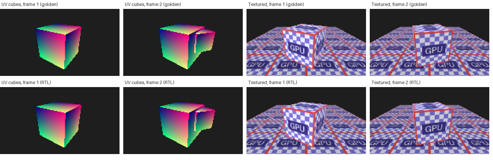
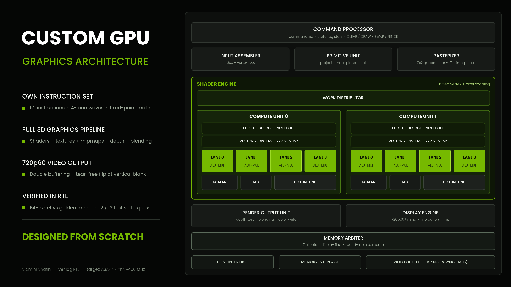

# Custom GPU — a graphics chip designed from scratch

**What is this?** A small graphics processor (GPU) that I designed completely myself:
its own instructions, its own hardware design, and its own tests. It takes a list of
drawing commands and produces moving 3D pictures and a video signal for a screen.

**Does it work?** Yes. The hardware design was tested against a reference program and
matched it on **every single pixel** of every picture.



---

## In simple words

A GPU is the part of a computer that draws pictures. To draw a 3D scene it repeats a few
steps millions of times. This project builds every one of those steps as real hardware:

| Step | What happens | Like... |
|---|---|---|
| 1. Read commands | The GPU reads a to-do list from memory ("clear the screen", "draw this cube") | Reading a recipe |
| 2. Move the corners | Small programs rotate the 3D object and place it in front of the camera | Turning a model in your hand |
| 3. Flatten to 2D | The 3D corners become points on the flat screen; hidden back sides are skipped | Taking a photo |
| 4. Fill the triangles | Every triangle is turned into the screen pixels it covers | Coloring inside the lines |
| 5. Color each pixel | Small programs pick each pixel's color, including pictures (textures) on surfaces | Painting with stickers |
| 6. Keep what's in front | Pixels behind other objects are thrown away | Near things hide far things |
| 7. Show it | The finished picture is sent to the screen, 60 times per second, without flicker | A TV showing frames |

---

## What makes it special

- **Everything is my own design** — the instruction set, the hardware, and the tests.
- **A complete chip, not just one part** — from the to-do list in memory all the way to the
  video signal for a monitor.
- **Carefully checked** — 12 test programs, thousands of random tests, all passing.
- **Built for a modern chip process** — designed to target 720p (1280 × 720) at 30 pictures
  per second on a 7 nm process (ASAP7).

---

## Results

| Test scene | Pictures | Pixels that match the reference | On the screen |
|---|---|---|---|
| Colored cubes (one alone, then two crossing each other) | 2 | 14,400 of 14,400 in each | Shown in order, no flicker |
| Cube with a picture on it, over a tiled floor | 2 | 14,400 of 14,400 in each | Shown in order, no flicker |

**All 12 test programs pass.**

---

## How it was built

1. **Learn by drawing in software first** — seven small Python programs, from one triangle to
   a textured 3D cube (`learning/`).
2. **Write the plan** — a design document describing every part of the GPU.
3. **Build a reference** — a Python program that behaves exactly like the GPU should.
   It is the "answer key".
4. **Build the hardware** — each part written in Verilog (a language for describing chips).
5. **Check against the answer key** — every part must give exactly the same numbers as the
   reference, bit for bit, even with random inputs.

The full story, including the bugs that were found and fixed, is in
[`docs/development_log.md`](docs/development_log.md).

---

## Try it yourself

You need Python and a free Verilog simulator called Icarus Verilog.
The easiest way is Google Colab (free, runs in your browser):

```
!apt-get install -y iverilog
%cd sim
!python run_all_tests.py
```

It runs all 12 tests (10–20 minutes) and prints a table. Every line should say **PASS**.

---

## What's in each folder

| Folder | What's inside |
|---|---|
| `sim/` | The hardware design, the reference program, and all tests |
| `pd/` | Scripts for turning the design into a real chip layout |
| `learning/` | The seven beginner drawing programs |
| `docs/` | Diagram, design document, results, development story |

---

## The main hardware parts



| Part | File | What it does |
|---|---|---|
| Command processor | `sim/gpu_top.v` | Reads the to-do list and controls everything |
| Compute units (2) | `sim/cu.v` | Run the small programs (shaders) for corners and pixels |
| Texture units (2) | `sim/tex_unit.v` | Read pictures (textures) and smooth them |
| Primitive unit | `sim/prim_unit.v` | Turns 3D corners into screen positions, skips hidden sides |
| Rasterizer | `sim/rasterizer.v` | Finds which pixels each triangle covers |
| Output unit | `sim/rop.v` | Keeps the nearest pixel, mixes colors, writes the picture |
| Display engine | `sim/display_engine.v` | Sends the finished picture to the screen |

---

## Next steps

- [x] Instruction set, reference program, all hardware parts, complete GPU with video output
- [ ] Turn the design into a chip layout on a 7 nm process (physical design)
- [ ] Make it faster (the triangle-filling step is the slowest part)
- [ ] Run it on an FPGA board and show it live on a monitor

---

## Words used here

| Word | Meaning |
|---|---|
| **GPU** | Graphics Processing Unit — the chip that draws pictures |
| **Instruction set (ISA)** | The list of commands the chip understands (this one has 52) |
| **RTL / Verilog** | A way of describing hardware in code, before it becomes a real chip |
| **Shader** | A small program that runs on the GPU for each corner or pixel |
| **Texture** | A picture placed on a 3D surface, like a sticker |
| **Golden model** | The reference program that gives the correct answers |
| **Pixel** | One dot of the picture |
| **720p** | A screen size of 1280 × 720 pixels |
| **7 nm / ASAP7** | A modern chip manufacturing size, and a free kit for designing with it |

---

## Author

**Siam Al Shafin** — EEE graduate, Islamic University of Technology (IUT).
I set the direction, made the design decisions, and ran every test.


